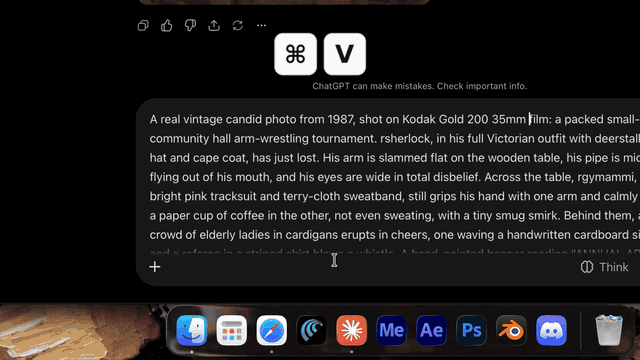

# RefTags

**Keep your AI characters' faces consistent.** Save a face once with a tag like `rsherlock`.
Type the tag in ChatGPT (or any app), press **⌃⌘V**, and the reference image is pasted in.
Paste a whole prompt with several tags and RefTags attaches the whole cast at once.



Made with Claude by someone with ADHD who kept forgetting to attach reference images.

## ⬇️ Download

**[Download RefTags.zip](https://github.com/HarshDezines/Reftags/releases/latest/download/RefTags.zip)** (macOS 13 or newer, Apple Silicon and Intel)

1. Unzip it and drag **RefTags** into your **Applications** folder.
2. Open it. macOS will say it can't check the app, because it isn't from the App Store. Go to
   **System Settings → Privacy & Security**, scroll down and click **Open Anyway**.
3. When asked, turn on **RefTags** under **Accessibility**. It needs this to notice your tags and paste images.

A small person icon appears in your menu bar. That's it.

## How to use

| What | How |
|---|---|
| Save a face | Copy an image (⌘C) → press **⌃⌘R** → type a name like `sherlock` → ↩ |
| Attach one face | Type `rsherlock` anywhere → a popup appears → **⌃⌘V** |
| Attach every face in a prompt | Paste a prompt that mentions `rsherlock`, `rgymma`… → popup → **⌃⌘V** |
| Ignore the popup | Just keep typing, or press Esc |
| Manage faces | Menu bar icon → **Open Library** (rename, delete, add more angles) |

- A tag can hold several images (front, side…). All of them get pasted.
- **Name label under pasted images** (on by default) writes the tag under each image, so ChatGPT knows which face is which character.
- Your clipboard is restored after pasting.
- Faces are stored as small JPEGs in `~/Library/Application Support/RefTags`. Unused tags are deleted after 14 days
  (change this in the menu), and **Clear All** wipes everything.

## Privacy

RefTags runs entirely on your Mac. It keeps the last few characters you typed in memory, only to
spot tags, and never saves or sends them anywhere. There is no network code at all. Read the source in `Sources/`.

## Build it yourself

```bash
xcode-select --install   # once, if you don't have Apple's command line tools
./build.sh               # builds, installs to /Applications and opens it
```

Shortcuts can be changed in `Sources/KeyMonitor.swift` (the `Hotkeys` section).

## License

MIT
